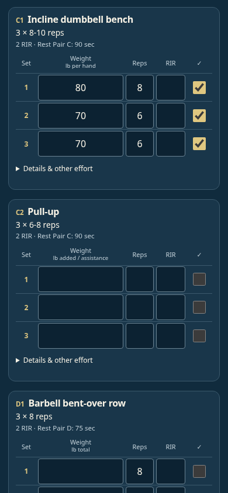
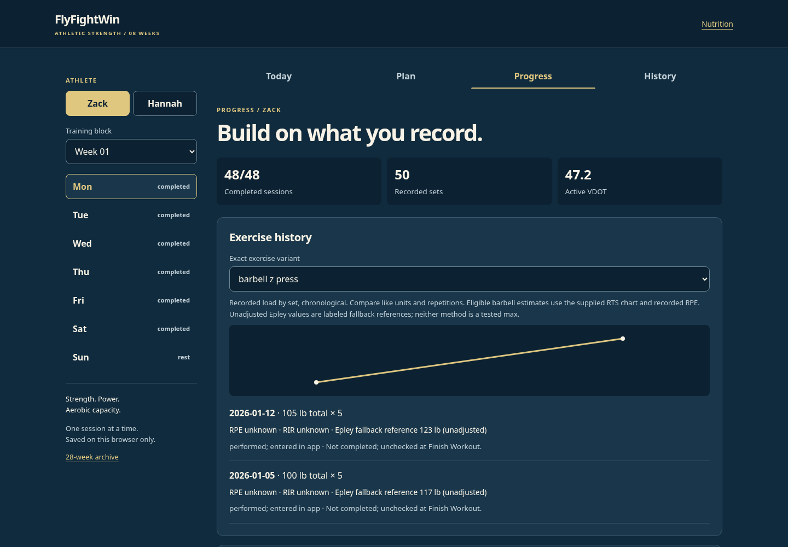

# Rendered interface

These are actual Chromium renders of the redesigned application. Every displayed performance/date is synthetic QA input, not athlete history. Phone viewport: 390×844. Desktop: 1440×1000.

| View | Screenshot |
|---|---|
| Compact mobile table (390 px) | [Three-set table](screenshots/mobile-compact-table.png) |
| Compact mobile table (320 px) | [Narrow table](screenshots/mobile-compact-table-320.png) |
| Compact desktop table | [Desktop logging](screenshots/desktop-compact-logging.png) |
| Phone workout | [Today](screenshots/mobile-today.png) |
| Main-lift loading and recorded top set | [Top set/back-offs](screenshots/mobile-main-lift.png) |
| Accessory set logging | [Accessory](screenshots/mobile-accessory.png) |
| Weekly plan | [Plan](screenshots/mobile-plan.png) |
| Exercise trends | [Phone progress](screenshots/mobile-progress.png) |
| Backup/restore | [History](screenshots/mobile-history.png) |
| Desktop workout | [Today](screenshots/desktop-today.png) |
| Desktop load trend | [Progress](screenshots/desktop-progress.png) |
| Week 4 reduced volume | [Monday](screenshots/mobile-week4-monday.png), [Wednesday](screenshots/mobile-week4-wednesday.png), [Friday](screenshots/mobile-week4-friday.png) |
| Week 8 reduced volume | [Monday](screenshots/mobile-week8-monday.png), [Wednesday](screenshots/mobile-week8-wednesday.png), [Friday](screenshots/mobile-week8-friday.png) |

